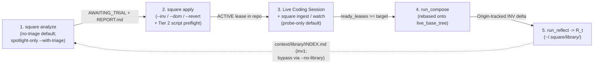

# Phase 2 Plan — Closing the Loop (Adoption, Probing, Composition & Library $\mathcal{R}_t$)

- **Status:** Completed (`2026-11-14` — `47/47` Unit Tests & Live Git Worktree Smoke Test Passing)
- **Prerequisites Completed (Phase 1):**
  - Clean full-session trajectory rendering (`base1.md` via `slicer.render_trace_markdown()`)
  - Multi-cluster `INV` & `DOM` proposer prompts + 3rd-party skill lockout (`ADR-004`, `ADR-005`)
  - 4-session empirical benchmark (`Stash`, `structure.ai`, `Hoster`, `StackedMedia` in [`docs/test_runs/README.md`](test_runs/README.md)) showing clean `base1.md` unlocks full-session `gpt-6.1-sol` extraction and that `gdm` triage helps as an **attention spotlight** (`3/4` wins) but hurts when used as a **hard dimension skip gate** (`StackedMedia`, `ADR-006`)

---

## 1. Phase 2 Objective & End-to-End Flow

Phase 1 solved **Single-Session Extraction** (`transcript.jsonl` $\to$ `REPORT.md`). Phase 2 closes the continual harness-improvement loop from human-reviewed proposals to live probing, asynchronous composition, and leak-proof cross-project `INV` compounding in `~/.square/library/<substrate>/`:

---

## 2. Locked Architectural Decisions (`ADR-007`)

1. **No-Triage Default + Spotlight-Only `--with-triage` in `square analyze`:** `square analyze` runs `inv1` and `dom1` in parallel directly on clean full-session `base1.md` by default (`use_triage=False`). When `--with-triage` is passed, `gdm` runs strictly as an **attention spotlight** (injecting episode/macro highlights scoring $\ge 0.45$ into `MISSION.md` while **never skipping** `inv1` or `dom1`, which eliminates the `StackedMedia` false negative at `0s` wall-time cost). `square scan` and `square triage` remain standalone discovery utilities.
2. **Explicit `square apply` Gate + Tier 2 Script Pre-Flight:** Reviewing `REPORT.md` is the human gate. `square apply [case_id|lease_id] [--inv] [--dom] [--revert] [--replace] [--force]` promotes selected `AWAITING_TRIAL` / `STAGED_TIER_2` leases to `ACTIVE`, running a fast import/`--help` smoke check on any `.py` scripts before materializing them into the workspace.
3. **Decouple Active-Lease Probing from Unreviewed Auto-Proposal:** Retire the overloaded `live_workspace: bool` switch that currently blocks `process_session()` and `run_compose()` under default CLI flags:
   - **New Proposals** (`analyze`, `ingest --propose`, `watch --propose`) *always* record as `AWAITING_TRIAL` without modifying target repo files.
   - **Active Leases** (materialized via `square apply`) are *always* stripped by `current_harness()`, probed by `square ingest` / `square watch` (which run probe-and-compose only by default, burning zero LLM calls on unrelated sessions), and composed by `run_compose()`.
4. **Asynchronous Ready-Lease Composition (`activations_target=1`) & Noise-Free Triggers:** `INV` and `DOM` trigger at different rates in real repositories. `process_session()` composes any lease in `case_id` that reaches `activations_target` (`ready_leases`) immediately without blocking behind an unactivated sibling dimension, while batching `INV` + `DOM` together when both activate in the same session. `match_activation()` excludes raw read-only tool outputs (`tc.output`) from `cue_keywords` matching so reading unrelated files never triggers false `IGNORED_BY_AGENT` rejections.
5. **Origin-Tracked `INV`-Only Continual Library ($\mathcal{R}_t$) & `--no-library` Isolation:** `~/.square/library/<substrate>/` is shared across repositories (`library_for()` unified across `analyze` and `run_reflect()`), mounted only for `INV` proposers (unless `--no-library` is set for clean A/B benchmarks), and stores **only component deltas originated by `INV` leases** — never leaking `DOM` skills or a repository's private `GEMINI.md` into global state.

---

## 3. Implementation Milestones & Code Changes

### Milestone 1: Streamline `analyze`, Surface Fidelity & Evidence Polish
- **[`square/cli.py`](../square/cli.py) & [`square/engine.py`](../square/engine.py):**
  - Default `analyze_session(..., use_triage: bool = False)` so `square analyze` runs without `gdm` triage unless `--with-triage` is passed on the CLI (keep `--no-triage` as a harmless alias).
  - When `use_triage=True` inside `analyze_session()`, run `gdm` in **spotlight-only mode**: always run both `inv1` and `dom1` in parallel and pass episode/macro spotlights (`threshold=0.45`) into `format_proposer_brief()`.
  - Populate `at_t_y_diff` and `survival_t_y1_diff` inside `analyze_session()` from intra-session `slicer.detect_semantic_revert(trace)` / mutation patches when present instead of leaving deliverable patches blank.
- **[`square/context.py`](../square/context.py):**
  - **Fix deliverable patch inlining:** Update `_inline_evidence_bundle()` (`L288`) to check `("slice_summary.md", "git_survival.patch", "at_T_Y.patch", "user_nudge.txt")` (plus legacy `.txt` fallbacks) so deliverable and survival diffs produced by `_load_base_rollout()` are actually inlined into `MISSION.md`.
  - **Read-only unmanaged skill manifest:** Keep 3rd-party/user skills excluded from editable `context/harness/`, **but** pass a compact read-only inventory (`name` + `description` of unmanaged `<skill_dir>/*/SKILL.md` files) into `MISSION.md` ("Pre-existing Read-Only Workspace Skills — Do Not Edit or Duplicate") and `summarize_current_harness()` so proposers never propose duplicates of already-installed skills.
- **[`square/substrates/antigravity.py`](../square/substrates/antigravity.py) & [`square/prompts.py`](../square/prompts.py):**
  - Set `AGY_SURFACE.skill_name_rule = "must_match"` so `.agents/skills/<name>/SKILL.md` must include `name: <name>` alongside `description:`.
  - Update `AGY_SURFACE.stubs` and `_SURFACE_AGY` in `prompts.py` to state that both `name:` (matching directory) and `description:` are required in `SKILL.md` frontmatter.
  - **Fix `antigravity.dom` prompt self-contradiction:** Update `_build_surface_texts()["antigravity"].dom` (`prompts.py` `L515–519`) to replace the legacy *"write that trigger line in `GEMINI.md`"* sentence with YAML frontmatter `name:` + `description:` auto-discovery guidance matching `_SURFACE_AGY`.
  - **Disable unsupported `sub_agents/` on `AGY_SURFACE`:** Add `allow_subagents: bool = True` to `SurfaceSpec`, set `allow_subagents=False` on `AGY_SURFACE` (removing the `sub_agents/README.md` stub and passing `surface.allow_subagents` in `_accept_tree()` / `HT.validate()`), preventing dead `<repo>/sub_agents/` folders on Antigravity workspaces.
- **[`square/tree.py`](../square/tree.py):**
  - Update `_check_script_refs()` so that inside `<skill_dir>/<skill>/SKILL.md`, a relative reference like `python3 scripts/<helper>.py` validates cleanly when either `scripts/<helper>.py` **or** `<skill_dir>/<skill>/scripts/<helper>.py` exists in `tree` (eliminating the `Hoster` `inv1.a1` validation retry).

### Milestone 2: Frictionless Candidate Adoption (`square apply`, Pre-Flight & Hygiene)
- **[`square/substrates/base.py`](../square/substrates/base.py) & [`square/engine.py`](../square/engine.py):**
  - **Fix status filter bug:** Update `_square_managed_skill_prefixes()` (`L263`) to check `status in ("ACTIVE", "COMPOSED")` instead of legacy `("TRIAL_ACTIVE", "PROMOTED")`.
  - **Always strip active leases in `current_harness()`:** Update `SquareEngine.current_harness()` (`engine.py` `L348–365`) so active non-always-on lease files (such as leased `.agents/skills/<name>/SKILL.md`) are *always* stripped/restored to `lease.base_tree` regardless of engine flags.
  - **Stamp managed skills:** When `apply_lease_to_workspace()` writes a newly created `<skill_dir>/<name>/SKILL.md`, append `<!-- square-managed -->` cleanly at EOF (preserving YAML frontmatter at byte 0) and record adopted paths in `managed_components.json` on composition.
  - **Clean directory revert:** Update `revert_lease_from_workspace()` so unlinking newly leased files under `<skill_dir>/<name>/scripts/` or `<skill_dir>/<name>/` removes empty parent directories up to `<skill_dir>` (leaving pre-existing user skills untouched).
- **[`square/lease.py`](../square/lease.py) & [`square/engine.py`](../square/engine.py):**
  - Add `engine.apply_case_leases(target_id: str | None = None, *, dims: set[Dimension] | None = None, replace: bool = False, force: bool = False)` and `engine.revert_active_leases(...)`:
    - Resolves `target_id` (specific `lease_id`, `case_id`, or latest `case_id` with `AWAITING_TRIAL` / `STAGED_TIER_2` leases).
    - **Tier 2 `.py` pre-flight check:** For any changed `.py` script in the candidate tree, verify top-level imports / run `python <script> --help` (3s timeout) before materializing; warn and abort if required packages are missing unless `--force` is set.
    - Checks for active slot conflicts (`has_active_slot`) and either warns or reverts/replaces the prior active lease when `--replace` is passed.
    - Rebases `lease.base_tree` & `lease.candidate_tree` onto `current_harness()` so edits made to `GEMINI.md` after `square analyze` are preserved cleanly.
    - Transitions status to `ACTIVE` and calls `sub.materialise_lease(repo_root, lease)`.
- **[`square/cli.py`](../square/cli.py) & [`GEMINI.md`](../GEMINI.md):**
  - Replace disabled `cmd_approve` with `square apply [target] [--inv] [--dom] [--revert] [--replace] [--force]` (keeping `approve` as an alias).
  - Update `square status` and the footer of `square analyze` to print exact `square apply <case_id>` commands, warn if `<!-- SQUARE_LEASE:` markers appear in `git status` / `HEAD`, and flag stale active leases (`unrelated_sessions_seen >= 10`).
  - Clean up Square's own [`GEMINI.md`](../GEMINI.md) (remove the orphaned `SQUARE_LEASE` wrapper and stale `ADR.md` / `HANDOVER.md` / `SessionTrace` claims).

### Milestone 3: Live Session Probing, Noise-Free Activation & Asynchronous Composition
- **[`square/engine.py`](../square/engine.py) & [`square/cli.py`](../square/cli.py):**
  - **Unblock `process_session()` & `run_compose()`:** Remove the `if not self.live_workspace: return self._process_offline(...)` early exit in `process_session()` (`L395`) and the `if not self.live_workspace: raise ValueError(...)` guard in `run_compose()` (`L850`).
  - **Probe-only default for `ingest` / `watch`:** By default, `square ingest` and `square watch` run Step 1 (evaluate `active_leases`, increment `unrelated_sessions_seen` or `activations_completed`, record probe rollouts, and run `run_compose` + `run_reflect` on `ready_leases`), incurring zero LLM calls when no lease completes. Add `--propose` to `ingest` / `watch` for opt-in background slice detection (`AWAITING_TRIAL`) on unleased dimensions.
  - **Clean probe trajectories:** Update `_record_probe_rollout()` to call `slicer.render_trace_markdown(trace, obs_trunc=4_000, read_obs_trunc=1_200, max_chars=0)`.
  - **Ready-lease composition:** In `process_session()`, replace `all(l.activations_completed >= l.activations_target for l in case_leases)` with `ready_leases = [l for l in case_leases if l.activations_completed >= l.activations_target]`, calling `run_compose(cid, ready_leases, substrate=sub)` whenever `ready_leases` is non-empty.
- **[`square/tree.py`](../square/tree.py):**
  - **Candidate tree rebasing:** Add `HT.rebase_candidate_tree(surface, live_base, old_base, old_candidate)` and apply it when building `PoolEntry` in `run_compose()` so an `INV` lease that composed in Session 2 is never overwritten when its sibling `DOM` lease composes in Session 5.
- **[`square/lease.py`](../square/lease.py) (`match_activation`):**
  - **Fix `situation_matched` read-dump noise:** Build the `cue_keywords` corpus strictly from `trace.task_prompt`, user turn text, assistant prose/reasoning, `trace.executed_commands`, and `trace.touched_paths` — excluding raw `tc.output` tool payloads so reading an unrelated file containing a keyword does not trigger `situation_matched=True` $\to$ `IGNORED_BY_AGENT`.
  - **Fix skill `component_invoked` false-positives:** Count `<skill_dir>/<name>/SKILL.md` as invoked only when a tool call reads/targets `<skill_dir>/<name>/SKILL.md` (e.g., `read_file`, `view_file`, `cat`, `rg`), invokes a dedicated `skill` tool naming `<name>`, or executes a bundled script under `<skill_dir>/<name>/scripts/`.
  - **Support skill-bundled scripts & `always_on` mounting:** Check `(norm.startswith("scripts/") or "/scripts/" in norm) and norm.endswith(".py")` against `trace.executed_commands`, and mark `always_on` rules as `MOUNTED_ALWAYS_ON` (judged by behavioral contrast in `run_compose` rather than 4-letter token overlap).

### Milestone 4: Leak-Proof `INV`-Only Cross-Project Continual Library ($\mathcal{R}_t$)
- **[`square/cli.py`](../square/cli.py) & [`square/engine.py`](../square/engine.py):**
  - **Unify library root + `--no-library` flag:** Update `library_for()` to always resolve to `self.library_root / sub.name` (`~/.square/library/<substrate>`), remove the dead `--global-library` CLI flag (`cli.py` `L650`), and add `--no-library` (`use_library: bool = True`) so benchmark runs in `docs/test_runs/` can isolate cold-start vs. warm-library performance cleanly.
  - **Scope library context to `INV`:** Pass `library_dir=(lib_dir if (dim == "INV" and self.use_library) else None)` in `run_propose()` so `dom1` focuses strictly on the target repository without cross-repo noise.
  - **Origin-tracked `inv_delta_tree` in `run_reflect()`:**
    - Diff `comp_stage.tree` against `live_base_tree` (captured immediately prior to `run_compose`, *not* `first.base_tree`, which may predate an earlier staggered sibling composition).
    - Restrict `.agents/skills/<name>/**` in `inv_delta_tree` strictly to skill prefixes originated by **`INV` leases** in `ready_leases` (`[p for l in ready_leases if l.dimension == "INV" for p in l.component_paths]`) — ensuring `DOM` skills never leak into `~/.square/library/` during joint `INV`+`DOM` composition.
    - Store newly added `INV` procedural lines in `always_on` (if any) in an `ALWAYS_ON_DELTA.md` sidecar rather than emitting partial `GEMINI.md` files, and skip `run_reflect()` entirely when `ready_leases` contains no `INV` lease or `inv_delta_tree` is empty.
- **[`square/tree.py`](../square/tree.py) & [`square/library.py`](../square/library.py):**
  - Add `ensure_always_on: bool = True` to `HT.write_tree()` and call `write_tree(..., stubs=False, ensure_always_on=False)` inside `Library.add()` so `harnesses/<id>/harness/` stores pure, self-contained `INV` components (`SKILL.md`, `scripts/*.py`, `hooks.json`) without empty `GEMINI.md` stubs.

---

## 4. Verification & Test Plan

1. **Unit & Regression Tests (`python -m unittest discover -s tests -v`):**
   - `tests/test_substrates_and_tree.py`:
     - `AGY_SURFACE` rejects `SKILL.md` missing `name:`, mismatching its directory, or attempting to add `sub_agents/*/AGENT.md`.
     - `_check_script_refs()` accepts `python3 scripts/helper.py` inside `.agents/skills/foo/SKILL.md` when `.agents/skills/foo/scripts/helper.py` exists.
     - `rebase_candidate_tree()` preserves intermediate `GEMINI.md` and skill additions across staggered sibling compositions.
     - Read-only unmanaged 3rd-party skills appear in `MISSION.md` summary while remaining absent from editable `context/harness/`.
   - `tests/test_lease_activation.py`:
     - **Read-output noise immunity:** `match_activation()` returns `UNRELATED_SESSION` (`0/1`) when a `cue_keyword` appears only inside a `read_file` `tc.output` payload on an unrelated task.
     - `match_activation()` marks a skill `IGNORED_BY_AGENT` if its name is only mentioned casually in prose without reading `SKILL.md`, and `ACTIVATED_AND_INVOKED` when `read_file` reads `SKILL.md` or a bundled `.agents/skills/<name>/scripts/*.py` runs.
     - `apply` $\to$ `revert` cleanly removes `<!-- SQUARE_LEASE -->` blocks, prunes empty `.agents/skills/<name>/` directories, and `current_harness()` strips active skill leases during concurrent `analyze`.
   - `tests/test_engine_loop.py`:
     - **Default CLI loop regression:** Run `analyze` $\to$ `apply` $\to$ `ingest` via `cli.main()` with default flags to verify `process_session()` probes, composes, and reflects without needing legacy `live_workspace=True` overrides.
     - Staggered `INV`-first probe composition $\to$ `DOM`-second probe composition (verifying `INV` survives `DOM` composition).
     - **Joint `INV` + `DOM` skill leak test:** Batch-compose an `INV` skill and a `DOM` skill in the same probe session; assert the `DOM` skill lands in `<repo>/.agents/skills/` and is **completely absent** from `~/.square/library/antigravity/`.
     - Verify `--no-library` suppresses mounting `context/library/` during `square analyze`.
2. **Live Repo Smoke Test:**
   - Clean Square's own [`GEMINI.md`](../GEMINI.md) and verify `square status` reports zero orphaned lease blocks.
   - Apply one real Phase 1 candidate (`StackedMedia` or `Hoster`) in a disposable git worktree via `square apply`, verify Tier 2 script pre-flight checks, inspect `square status` and `git diff`, run `square apply --revert` to confirm zero residue, then re-apply and run a probe `square ingest` to inspect the `COMPOSE` diff and `~/.square/library/antigravity/INDEX.md` entry.
